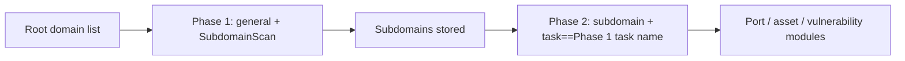

# ScopeSentry MCP Usage Guide

For users with an **already-deployed ScopeSentry instance**. Connect to the platform via Cursor (or another MCP client); no local source code required.

## 1. Preparation

### 1.1 Confirm the Service Is Reachable

- Default web UI: `http://<host>`
- MCP endpoint: `http://<host>/mcp` (if there is a reverse proxy or frontend proxy in front, use the actual `/mcp` address)

### 1.2 Create an API Key

1. Log in to the ScopeSentry web UI in a browser
2. Go to the **API Key** management page and create a key (or create one via an admin-provided endpoint)
3. Save the returned `ssk_...` string (**shown only once**)

### 1.3 Configure Cursor MCP

Cursor → Settings → MCP → Add server:

```json
{
  "mcpServers": {
    "scopesentry": {
      "url": "http://<your-host>:8082/mcp",
      "headers": {
        "X-API-Key": "ssk_your-key"
      }
    }
  }
}
```

You can also use: `Authorization: Bearer ssk_your-key`

After configuring, restart MCP or reload Cursor, and confirm that tools like `list_projects` and `list_assets` appear in the tool list.

---

## 2. Tool Overview


| Tool                     | Purpose             |
| ---------------------- | ----------------- |
| `list_projects`        | Project tree grouped by tag (includes project ID) |
| `list_projects_data`   | Paginated project list, searchable by name |
| `get_project`          | Project details     |
| `create_project`       | Create a project    |
| `list_tasks`           | Scan task list      |
| `get_task`             | Task details        |
| `list_scan_templates`  | Scan template list  |
| `get_scan_template`    | Template details    |
| `list_plugin_modules`  | Scan pipeline module names |
| `list_plugins`         | Available plugins (with hash, default parameters) |
| `create_scan_template` | Create a scan template |
| `create_scan_task`     | Create a scan task  |
| `list_assets`          | Query assets of all kinds (paginated list) |
| `count_assets`         | Count assets (`/api/assets/common/total`) |
| `get_asset_detail`     | Asset or vulnerability details |
| `add_asset_tag`        | Add a tag to an asset |
| `list_nodes`           | Scan node list      |


Each tool's parameters follow the MCP tool description (schema); the search and filter syntax for `list_assets` / `count_assets` is identical, so read the `list_assets` description before querying assets.

When you need to know "how many in total", use `count_assets` (which maps to the web pagination-total endpoint) rather than repeatedly paging through `list_assets` just to count.

---

## 3. Common Workflows

### 3.1 Query Assets by Project

When the user or context **already has a project condition**, prefer adding `filter.project` to narrow the scope and avoid slow responses from too much cross-project data. If there is no clear project, you do not have to force a project filter.

1. `list_projects` or `list_projects_data` to get the target project's **ObjectID** (`id` / `children[].value`)
2. `list_assets` with `filter.project` (**must be the ID, not the project's Chinese name**)

```json
{
  "asset_type": "asset",
  "pageIndex": 1,
  "pageSize": 20,
  "search": "domain=^example.com",
  "filter": {
    "project": ["<project ObjectID>"]
  }
}
```

### 3.2 Create a Scan Task

1. `list_nodes` to get online node names
2. `list_scan_templates` or `create_scan_template` to get the template **ObjectID**
3. `create_scan_task`: `name` and `node` are required; `template` takes the template ID (not the template name)

**Target source `targetSource` (same as the web UI):**

| targetSource | Description | Required params |
| --- | --- | --- |
| `general` | Enter targets directly | `target` |
| `project` | Read targets from a project | `project` (array of project ObjectIDs) |
| `asset` | Search the web asset store | `search`; optional `project`, `filter`, `targetNumber` |
| `RootDomain` | Search the root-domain store | `search`; optional `project`, `filter`, `targetNumber` |
| `subdomain` | Search the subdomain store | `search`; optional `project`, `filter`, `targetNumber` |
| `UrlScan` | Search URL scan results | `search`; optional `project`, `filter`, `targetNumber` |
| `*Source` (e.g. `subdomainSource`) | Create from the asset page's "selected/searched" | `search` when `targetTp=search`; `targetIds` when `targetTp=select` |

**Example — scan root domains directly:**

```json
{
  "name": "example-subdomain-collection",
  "node": ["node-1"],
  "template": "<template ObjectID>",
  "targetSource": "general",
  "target": "example.com\nfoo.com",
  "project": ["<project ObjectID>"]
}
```

**Example — continue scanning from the subdomain store (filter by the previous task name):**

```json
{
  "name": "example-ports-and-vulns",
  "node": ["node-1"],
  "template": "<follow-up-module template ObjectID>",
  "targetSource": "subdomain",
  "search": "task==\"example-subdomain-collection\"",
  "project": ["<project ObjectID>"]
}
```

### 3.3 Full Information Collection for a Root Domain (Two-Phase Recommended)

When the input is a **root domain** and you want **full information collection**, scan in two passes rather than running the whole pipeline at once.

**Reason:** distributed tasks are dispatched per **individual target**. When a root domain is the target, whichever node it is assigned to will also run the follow-up modules for the subdomains it finds on that same node, which easily causes uneven load, slow speed, and errors.

**Best practice:**

1. **Phase 1 — subdomain collection only**
   - `targetSource`: `general`
   - `target`: all root domains (multi-line)
   - Template: enable only `SubdomainScan`, `SubdomainSecurity` (subdomain scan + subdomain takeover)
   - Use `get_task` to wait for the task to complete

2. **Phase 2 — follow-up modules**
   - `targetSource`: `subdomain`
   - `search`: `task=="<Phase 1 task name>"` (exact match on the task name)
   - Optional `project` to narrow the scope
   - Template: port scan, asset mapping, vulnerability scan, etc. (may exclude SubdomainScan)
   - Subdomains are dispatched to nodes as independent targets, for higher parallel efficiency

You can also achieve the same effect in the web UI by filtering the "subdomain" asset page by task name and using "create task from subdomains".



### 3.4 Create a Scan Template

1. `list_plugin_modules` → module name list
2. `list_plugins` (filterable by `module`) → each plugin's `hash` and default `parameter`
3. `create_scan_template`: use `modules` to specify "module → array of plugin hashes"

---

## 4. Asset Queries (`list_assets` / `count_assets`)

`count_assets` uses the same `asset_type`, `search`, and `filter` as `list_assets`, and returns `{ "total": N }`, mapping to the web `/api/assets/common/total`.

```json
{
  "asset_type": "subdomain",
  "search": "task==\"some task name\"",
  "filter": {"project": ["<project ObjectID>"]}
}
```

**Performance tips (common to `list_assets` / `count_assets`):** when there is a project condition, prefer `filter.project` to narrow the scope; in `search`, use `==` exact match or `^` prefix match on indexed fields where possible (see [4.3](#43-search-expression)), avoiding broad `=` fuzzy queries that slow responses. When there is no project context, do not force a project filter.

See the table in [4.4](#44-filter-exact-filtering) for which types support `filter.project`.

### 4.1 Asset Type `asset_type`

`asset`, `RootDomain`, `subdomain`, `app`, `mp`, `UrlScan`, `SensitiveResult`, `DirScanResult`, `crawler`, `vulnerability`, `PageMonitoring`, `IPAsset`, `SubdomainTakerResult`

Alias examples: `web`→asset, `vuln`→vulnerability, `ip`→IPAsset, `url`→UrlScan

### 4.2 Parameter Notes


| Parameter                | Description                             |
| ------------------------ | --------------------------------------- |
| `pageIndex` / `pageSize` | pagination, defaults 1 / 20             |
| `search`                 | search expression (see next section)    |
| `filter`                 | exact-filter JSON (see next section)    |
| `sort`                   | only UrlScan, DirScanResult support sorting by `length` |
| `sid`                    | SensitiveResult only: sensitive rule name |


`search` and `filter` **can be used together**.

### 4.3 search Expression

A custom DSL (**not SQL**):


| Operator | Meaning | Index | Example                      |
| ---- | ---- | ---- | --------------------------- |
| `=`  | fuzzy match (regex) | no index | `domain=example`            |
| `==` | exact match (equality) | **uses index** | `port==443`                 |
| `!=` | exclude   | — | `port!="80"`                |
| `&&` | and    | — | `domain==example.com && port==443` |
| `||` | or    | — | `title=admin || body=login` |


**Indexes and operators:** fields such as `domain`, `ip`, `port`, `title` are indexed, but only **`==` equality** or a **prefix match whose value starts with `^`** (e.g. `domain=^example.com`) can use the index; **`=` becomes a regex fuzzy match and cannot use the index**, which slows down on large datasets.

**search fields common to all types:** `tag`, `task` (task name), `rootDomain`

**`project` cannot be written in `search`** (invalid, or errors when combined with `&&`). To filter by project, use `filter.project`.

**Common search fields per type:**


| asset_type           | Fields                                                                               |
| -------------------- | ----------------------------------------------------------------------------------- |
| asset                | domain, ip, port, service, app, title, statuscode, icon, banner, type, body, header |
| RootDomain           | domain, icp, company                                                                |
| subdomain            | domain, ip, type, value                                                             |
| app                  | name, icp, company, category, description, url, apk                                 |
| mp                   | name, icp, company, category, description, url                                      |
| UrlScan              | url, input, source, resultId, type                                                  |
| SensitiveResult      | url, sname, body, info, md5                                                          |
| DirScanResult        | url, statuscode, redirect, length                                                   |
| vulnerability        | url, vulname, matched, request, response, level                                     |
| crawler              | url, method, body, resultId                                                          |
| PageMonitoring       | url, hash, diff, response                                                            |
| IPAsset              | ip, domain, port, service, webServer, app                                           |
| SubdomainTakerResult | domain, value, type, response                                                        |


**search examples:**

- `domain==www.example.com && port==443` (exact, uses index)
- `domain=^example.com` (prefix match, uses index)
- `ip==192.168.1.1`
- `task=="some task name"`
- `level==high` (vulnerability)
- `statuscode==200` (DirScanResult)

Use `=` when you need fuzzy containment, e.g. `title=admin` (no index; best combined with conditions like project to narrow the scope).

### 4.4 filter (Exact Filtering)

A JSON object: multiple values for the same key are **OR**, different keys are **AND**.

**Prefer `project` when there is a project condition:** if the user or context has an explicit project and the asset_type supports `project`, include it to narrow the scope; do not force it when there is no project information.


| filter key   | Meaning    | Value notes                                              |
| ------------ | -------- | -------------------------------------------------------- |
| `project`    | owning project | **ObjectID**, obtained via `list_projects` / `list_projects_data` |
| `task`       | source task | **task name**, from `list_tasks`'s `name`                |
| `port`       | port       | e.g. `"443"`                                             |
| `service`    | service/protocol | e.g. `"https"`                                     |
| `app`        | app fingerprint | e.g. `"Nginx"`                                      |
| `icon`       | icon hash  |                                                          |
| `statuscode` | HTTP status code | mainly for asset                                   |
| `status`     | status     | UrlScan/DirScan HTTP code; vulnerability/sensitive-info processing status |
| `level`      | vulnerability level | critical / high / medium / low / info           |
| `type`       | type       | e.g. subdomain record type A, CNAME                      |
| `color`      | sensitive rule color | SensitiveResult                                |
| `sname`      | sensitive rule name | SensitiveResult                                 |
| `tags`       | tags       |                                                          |


**Available filter keys per type:**


| asset_type                            | filter key                                                      |
| ------------------------------------- | --------------------------------------------------------------- |
| asset                                 | project, port, service, app, icon, statuscode, type, task, tags |
| RootDomain                            | project, tags                                                   |
| subdomain                             | project, type, task, tags                                       |
| app / mp                              | project, tags                                                   |
| UrlScan                               | status, tags                                                    |
| DirScanResult                         | status, tags                                                    |
| SensitiveResult                       | status, color, sname, tags                                      |
| crawler                               | project, task, tags                                             |
| vulnerability                         | project, level, status, task, tags                              |
| PageMonitoring / SubdomainTakerResult | tags                                                            |
| IPAsset                               | project, port, service, app                                     |


**filter example:**

```json
{"project": ["<project ObjectID>"], "port": ["443"]}
```

**Combined query example:**

```json
{
  "asset_type": "asset",
  "search": "domain=^baidu && port==443",
  "filter": {"project": ["<project ObjectID>"]},
  "pageIndex": 1,
  "pageSize": 10
}
```

**Notes:**

- Prefer `filter.project` when there is a project condition (if supported); it is not required without project context
- Do not put the project display name in `filter.project`
- Use `==` for known values and `^` for prefixes; avoid overusing `=` fuzzy match on large tables
- For UrlScan HTTP status use `filter.status`; for DirScanResult you can use `statuscode==200` in search
- For SensitiveResult by rule name: use `sname=rule name` in `search`, or `filter.sname`

### 4.5 Sorting with sort

Only **UrlScan** and **DirScanResult** support it:

```json
{"length": "ascending"}
```

Other types ignore `sort` and use the default sort by time.

---

## 5. Scan Template Module Names

`TargetHandler`, `SubdomainScan`, `SubdomainSecurity`, `PortScanPreparation`, `PortScan`, `PortFingerprint`, `AssetMapping`, `AssetHandle`, `URLScan`, `WebCrawler`, `URLSecurity`, `DirScan`, `VulnerabilityScan`, `PassiveScan`

---

## 6. Troubleshooting


| Symptom     | Fix                                                |
| --------- | -------------------------------------------------- |
| MCP has no tools | Check the URL, API Key, and whether ScopeSentry is running |
| 401 / 403 | Re-create or replace the API Key                   |
| Assets not found | Confirm `filter.project` is an ObjectID; do not write project in search |
| Template/task creation fails | `template` must be a template ObjectID; `node` takes an online node name |
| Query very slow/stuck | Add `filter.project` when there is a project; in search use `==` or `^` prefix on indexed fields instead of `=`; reduce `pageSize` |


---
